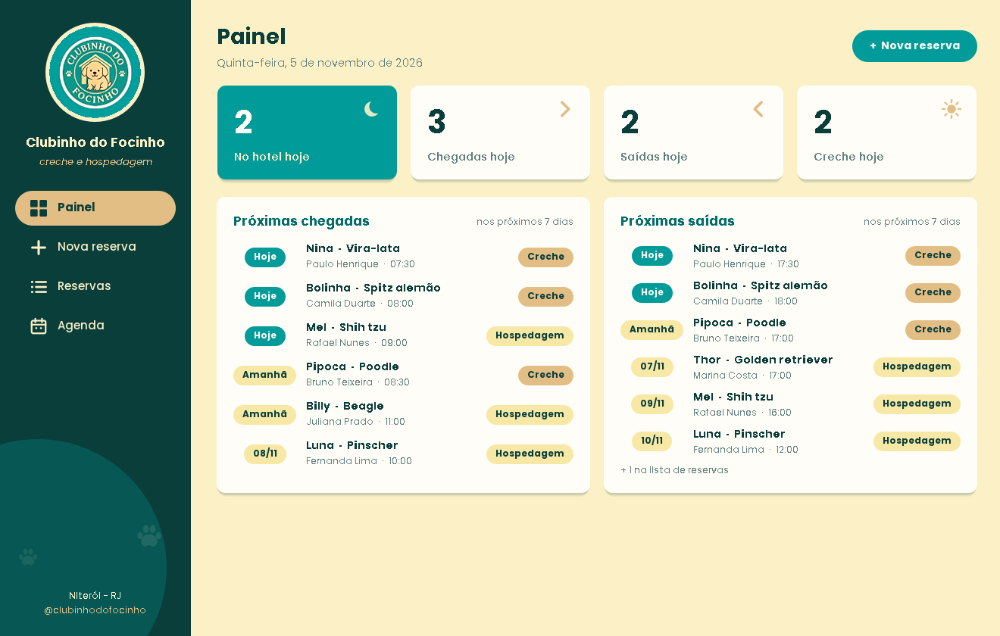
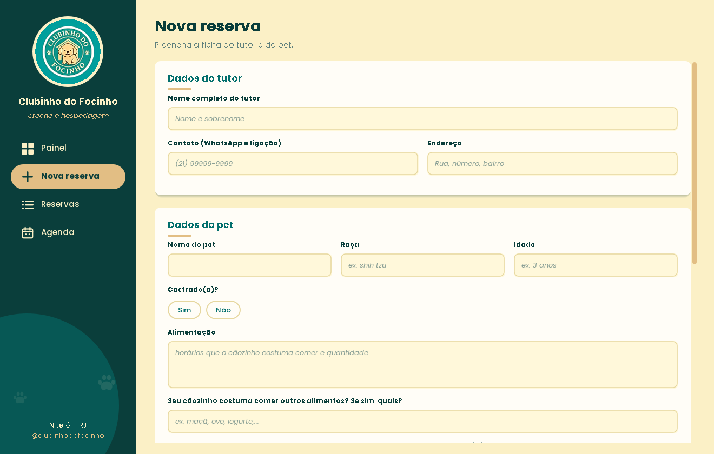
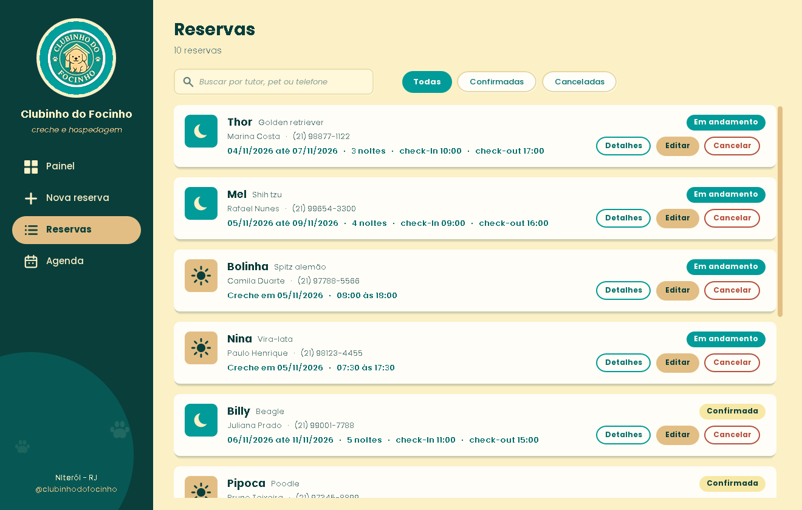
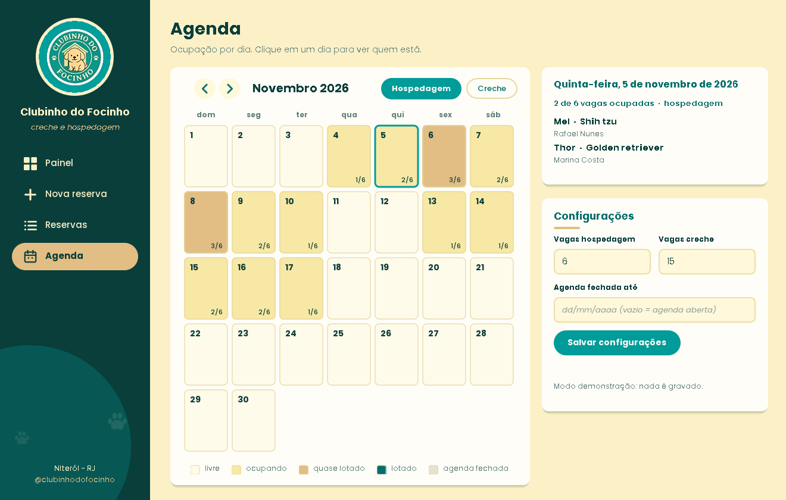

# 🐾 Clubinho do Focinho — Sistema de Reservas

Sistema desktop em **Java (Swing)** para controlar as reservas de **hospedagem** e **creche** do Clubinho do Focinho, um hotel para cachorros em Niterói - RJ.

Foi desenvolvido para uso real no dia a dia do hotel, com a **identidade visual da marca** (cores, fonte e logotipo) e pensado para ser aberto com **duplo clique**, sem precisar de IDE nem de conhecimento técnico.


## Telas

| Painel | Nova reserva |
|---|---|
|  |  |

| Reservas | Agenda |
|---|---|
|  |  |

> As imagens usam reservas fictícias do modo demonstração.

## Funcionalidades

- **Painel:** pets no hotel hoje, chegadas, saídas e creche do dia, com as próximas chegadas e saídas dos próximos 7 dias.
- **Nova reserva:** ficha completa do tutor e do pet (alimentação, outros alimentos, medicação, comportamento, datas e horários de check-in/check-out). Datas, horas e telefone têm máscara de digitação, e as dicas dos campos somem quando a pessoa começa a escrever.
- **Reservas:** lista com busca (tutor, pet ou telefone), filtros por situação e serviço, detalhes da ficha, edição e cancelamento.
- **Agenda:** calendário mensal com a ocupação de cada dia, detalhes de quem está no dia escolhido, número de vagas configurável e fechamento da agenda até uma data.

## Regras de negócio

- **Hospedagem** ocupa uma vaga por **noite** (entrada inclusive, dia da saída não conta). Quem sai no dia 10 libera a vaga para quem entra no dia 10.
- **Creche** ocupa uma vaga apenas no dia da entrada.
- A reserva é recusada se algum dia do período já estiver com todas as vagas ocupadas.
- Cancelar libera as vagas; editar confere as vagas de novo, sem contar a própria reserva.
- Reservas novas não podem ter entrada no passado.
- Se o pet toma medicação, é obrigatório informar qual e os horários.
- **Agenda fechada até uma data** bloqueia novas reservas nesse período.
- Vagas por dia configuráveis (padrão: 10 de hospedagem e 15 de creche).

## Como executar

**Requisito:** Java 17 ou mais novo.

| Sistema | Como abrir |
|---|---|
| Windows | duplo clique em `Abrir Clubinho do Focinho.bat` |
| Mac / Linux | `./executar.sh` |
| Terminal | `java -jar ClubinhoReservas.jar` |

- **Modo demonstração** (reservas de exemplo, nada é gravado): `Abrir Clubinho (demonstracao).bat` ou `java -jar ClubinhoReservas.jar --demo`.
- **Atalho com o ícone do Clubinho na área de trabalho (Windows):** `Criar atalho na area de trabalho.bat`.
- **Compilar** (JDK 17+): `compilar.bat` (Windows) ou `./compilar.sh`.

## Onde ficam os dados

Os dados são gravados na pasta do usuário, sempre no mesmo lugar, independentemente de onde o programa foi aberto:

```
C:\Users\<usuário>\ClubinhoDoFocinho\dados
├── reservas.tsv         # uma reserva por linha (abre no Excel)
├── reservas.tsv.bak     # cópia da versão anterior, criada a cada gravação
└── config.properties    # vagas por dia e fechamento da agenda
```

Para usar outra pasta: `java -Dclubinho.dados=C:\caminho -jar ClubinhoReservas.jar`.

## Testes

As regras de negócio (validação, vagas por noite, cancelamento, agenda fechada, busca e gravação em arquivo) têm testes simples, sem bibliotecas externas:

```bash
# Mac / Linux
javac -encoding UTF-8 -d out $(find src teste -name '*.java')
java -cp out clubinho.TesteRegras
```

```powershell
# Windows (PowerShell)
javac -encoding UTF-8 -d out (Get-ChildItem src,teste -Recurse -Filter *.java | ForEach-Object FullName)
java -cp out clubinho.TesteRegras
```

## Estrutura do projeto

```
src/clubinho/
├── App.java              # ponto de entrada (--demo)
├── model/                # Reserva (record), Servico, Status
├── data/                 # ReservaRepository (arquivo), Config, DemoData
├── service/              # ReservaService: regras de vagas e validação
├── util/                 # Fmt: datas e horas em pt-BR
└── ui/                   # tema da marca, componentes e telas
resources/                # logo, ícone e fonte Poppins
teste/                    # testes das regras de negócio
docs/                     # imagens do README
```

## Decisões técnicas

- **Zero dependências externas:** só o JDK, o que facilita instalar e manter no computador de quem usa.
- **Regras separadas da interface:** toda a lógica de vagas e validação fica em `service`, e pode ser testada sem abrir nenhuma janela.
- **Persistência simples e segura:** arquivo TSV com escape de caracteres especiais, gravação atômica (arquivo temporário + substituição) e cópia de segurança `.bak`.
- **Interface com a identidade da marca:** componentes próprios desenhados em Java2D (painéis arredondados, botões em pílula, campos com dica que some ao digitar, calendário de ocupação) e ícones desenhados em código.
- **Resiliência de recursos:** a fonte e o logo são procurados na pasta `resources`, e o logo/ícone também ficam embutidos no código como garantia.

## Identidade visual

| Cor | Hex |
|---|---|
| Verde Clubinho | `#019B99` |
| Verde escuro | `#026F6D` |
| Verde tinta | `#0A3E3B` |
| Creme | `#FBF0C6` |
| Bege | `#E2BE84` |

Fonte: **Poppins**.

## Próximos passos

- [ ] Valor da diária e total da estadia
- [ ] Mensagem de confirmação pronta para enviar por WhatsApp
- [ ] Gerar a ficha da reserva em PDF
- [ ] Lista do dia para imprimir
- [ ] Histórico por pet

## Autora

**Amanda Maricato** — UX/UI Designer e estudante de Ciência da Computação.

[GitHub](https://github.com/amandamrct) · [LinkedIn](https://www.linkedin.com/in/amanda-maricato-175b1b1b5/) · [Behance](https://www.behance.net/amandamaricato)

## Créditos

Fonte [Poppins](https://fonts.google.com/specimen/Poppins), licenciada sob a SIL Open Font License 1.1.
